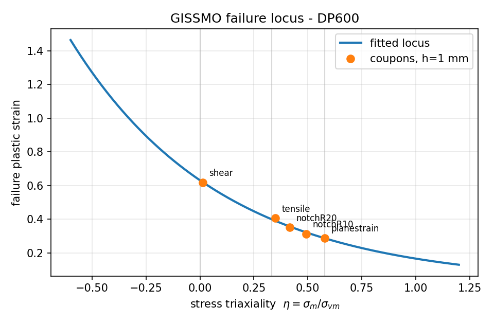
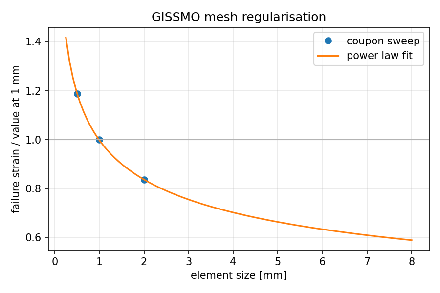

# 02 - GISSMO damage calibration

A single `FAIL` value on `*MAT_024` is only correct for the one stress
state it was fitted to. Real crash decks use a failure strain that
depends on stress triaxiality, calibrated on a set of coupons that each
sit at a different point on the failure locus. This study is that whole
workflow, end to end.

## The coupon set

| specimen | nominal triaxiality | loads |
|---|---|---|
| shear | 0.00 | in-plane shear ligament between two offset slots |
| tensile dogbone | 0.33 | uniaxial tension |
| notched R20 | 0.40 | mild notch constraint |
| notched R10 | 0.48 | sharp notch constraint |
| plane strain | 0.58 | wide grooved specimen |

Each is generated at 0.5, 1.0 and 2.0 mm element size - fifteen models
in total.

```bash
python3 build.py
python3 ../tools/mesh_quality.py models/*.k
```

## The workflow

1. Pull each coupon in the simulation until the virtual extensometer
   displacement matches the displacement at fracture measured on the rig.
2. At that instant, read the effective plastic strain and the stress
   triaxiality of the critical element. That is one point on the locus.
3. Repeat across all five stress states.
4. Fit and tabulate as `LCSDG`.
5. Repeat at every element size to build the regularisation curve.

Step 5 is the one that gets skipped, and it is why a "calibrated" damage
card so often fails to transfer to the vehicle model. Failure strain in a
shell model is mesh dependent: the strain localises into whatever element
size you gave it. A locus fitted on a 1 mm coupon mesh and used unscaled
on a 5 mm crash mesh predicts fracture far too late.

```bash
python3 calibrate.py --refsize 1.0 --target-size 5.0
```

Writes `results/gissmo_dp600.k` (an include-ready `*MAT_ADD_EROSION` card
with both curves), `results/failure_locus.png`,
`results/regularisation.png` and a fit report.




## Sample output with the bundled placeholder data

```
locus                eps_f = 0.0200 + 0.6105*exp(-1.4345*eta)
RMS error            0.0081 plastic strain
worst point error    3.6 %

  pure shear           eta= 0.000   eps_f=0.630
  uniaxial tension     eta= 0.333   eps_f=0.398
  plane strain         eta= 0.577   eps_f=0.287
  equibiaxial          eta= 0.667   eps_f=0.255

mesh regularisation  ratio = 0.997 * (h/1)^-0.253
  at h=5 mm the failure strain scales by 0.663
```

That last line is the point of the study: without regularisation the
crash mesh would be about 50 % too ductile.

## GISSMO parameters and what they do

| parameter | role |
|---|---|
| `LCSDG` | failure plastic strain against triaxiality - the locus fitted here |
| `DMGEXP` | how non-linearly damage accumulates; 2 is the usual starting point |
| `DCRIT` | damage at which the stress starts to fade rather than the element simply dying |
| `FADEXP` | how fast the stress fades between `DCRIT` and 1 |
| `LCREGD` | mesh regularisation factor against element size |
| `NUMFIP` | how many integration points must fail before the element is deleted |

`DCRIT` and `FADEXP` control instability and post-critical softening.
Leaving `DCRIT` at 0 makes the element vanish the instant damage reaches
1, which produces a force drop that is far too abrupt and is visible as a
spike in the contact force.

## Data file

`data/coupon_results.csv` ships with representative placeholder values so
the pipeline runs out of the box. Replace them with your own before
quoting anything.
