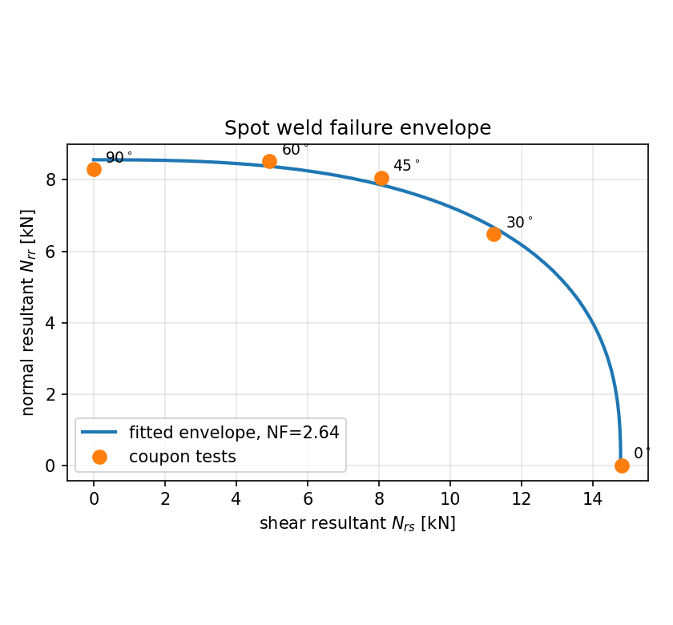

# 04 - Spot weld failure envelope

A body-in-white crash model lives or dies on its spot welds. There are
several thousand of them, each represented by one beam or solid element,
and their failure decides whether a joint tears open or a section stays
closed and keeps absorbing energy.

## The specimen

One geometry, loaded at a sweep of angles, the way a KS-II style test is
run. At 0° the weld sees pure shear, at 90° pure normal load, and 30°,
45° and 60° fill in the envelope between them.

| | |
|---|---|
| sheets | 60 × 40 × 1.5 mm, DP600, single overlap of 40 mm |
| nugget | 5 mm diameter, beam element, `*MAT_SPOTWELD` |
| tie | `*CONTACT_SPOTWELD`, beam nodes at an element centroid |
| load angles | 0, 30, 45, 60, 90 degrees |

The weld nodes are placed at an element centroid rather than on a shell
node on purpose: a tied contact wants to project onto a segment interior,
and coincident nodes are a common source of initial penetration warnings
that people then suppress instead of fixing.

## The failure surface

`*MAT_SPOTWELD` fails on force resultants:

```
(|N_rr| / NRR)^NF  +  (|N_rs| / NRS)^NF  =  1
```

with `N_rr` the axial (normal) resultant and `N_rs` the shear resultant.
A weld quoted only by its lap-shear strength is a single point on a
two-dimensional surface. Crash loading is mixed-mode almost everywhere,
and `NF` controls how much strength survives that mixing - taking `NF = 2`
by default, as many decks do, can be off by tens of percent in the
mid-angle range.

```bash
python3 build.py
python3 calibrate.py
```



## Sample output with the bundled placeholder data

```
NRR (normal)     8.5641 kN
NRS (shear)      14.7732 kN
NF  (exponent)   2.637
NRS/NRR ratio    1.725

  angle   test kN    fit kN   error %
    0.0    14.800    14.774      -0.2
   30.0    12.950    13.142       1.5
   45.0    11.400    11.170      -2.0
   60.0     9.850     9.687      -1.7
   90.0     8.300     8.566       3.2
```

`NF` above 2 means the weld keeps more strength under mixed loading than
an elliptical envelope would predict. Writes
`results/mat100_spotweld.k` and `results/weld_envelope.png`.

## Using the result

The calibrated card drops straight into a sub-assembly or full BIW model.
Two things to carry across with it:

**Sheet failure competes with weld failure.** In these decks the weld
failure limits are left blank so the peak load is governed by the sheet.
A real joint fails either by nugget pull-out through the sheet or by
interfacial fracture of the nugget, and which one wins depends on sheet
thickness and nugget diameter. If your coupons pull out, the number you
have calibrated is the sheet's, not the weld's.

**Weld strength is mesh dependent too.** The force a tied weld transmits
depends on how many shell elements it is tied into. Calibrating on a 2 mm
coupon mesh and applying to a 5 mm BIW mesh has the same transfer problem
as the damage locus in study 02.

## Data file

`data/weld_tests.csv` ships with representative placeholder values.
Replace with your own test or `swforc` results.
