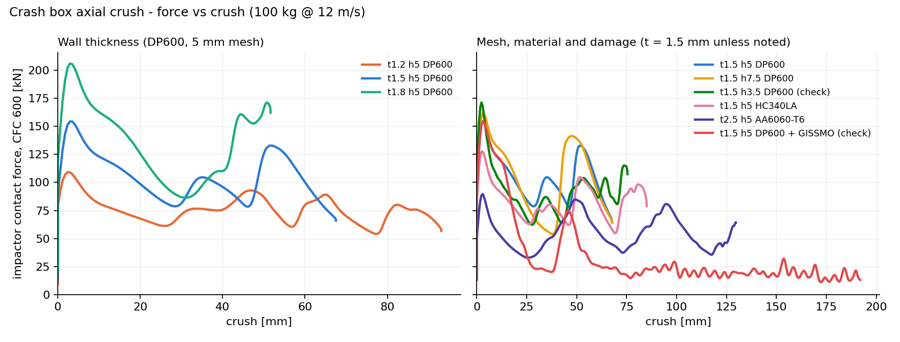

# LS-DYNA crash and sheet metal studies

Four LS-DYNA studies covering crashworthiness and sheet metal forming,
built as a reproducible pipeline rather than as a folder of model files.
Every mesh is generated from Python, every deck is written through one
keyword formatter, and every run is checked against explicit acceptance
criteria before its results are believed.

| | study | what it demonstrates |
|---|---|---|
| 01 | [Crash box axial crushing](01_crashbox_axial/) | explicit crash, mesh convergence, mass scaling and hourglass control, SEA / CFE evaluation |
| 02 | [GISSMO damage calibration](02_gissmo_calibration/) | five-stress-state coupon set, failure locus fitting, mesh regularisation |
| 03 | [Deep draw and springback](03_deepdraw_springback/) | MAT_036 Barlat forming, explicit-to-implicit handover, springback geometry evaluation, FLD |
| 04 | [Spot weld failure envelope](04_spotweld_coupons/) | MAT_100 resultant failure surface fitted from a load-angle sweep |

Studies 02 and 04 are calibration workflows that end by writing the
material cards studies 01 and 03 consume. If you only look at one, look
at 02.

### Headline result - crash box, 100 kg at 12 m/s



| DP600, 5 mm mesh | peak [kN] | mean [kN] | CFE | SEA [kJ/kg] |
|---|---|---|---|---|
| t = 1.2 mm | 109 | 77 | 0.71 | 26.3 |
| t = 1.5 mm | 154 | 106 | 0.69 | 29.0 |
| t = 1.8 mm | 206 | 139 | 0.67 | 31.5 |

All three pass the energy balance checks; 5 mm and 7.5 mm meshes agree on
mean crush force within 0.5 %. The aluminium variant (2.5 mm AA6060-T6)
absorbs the same energy at 55 kN mean force over 130 mm of stroke. Full
table, mesh and material comparison and failure diagnoses in
[study 01](01_crashbox_axial/).

## Why it is organised this way

Most simulation portfolios are a set of screenshots. The intent here is
to show the parts of the job that are not visible in a contour plot:

**Models are generated, not drawn.** There is no CAD file and no binary
mesh in the repository. `build.py` in each study writes the mesh and the
deck from parameters, so a reviewer can regenerate everything, change a
thickness, and get a consistent model back. A parameter study is a loop,
not an afternoon of clicking.

**Deck syntax is written once.** `tools/kfile.py` owns the fixed-format
card layout. If a card changes between solver releases it is fixed in one
place rather than in every model file.

**Quality is checked before the solver, not after.** `tools/validate_k.py`
catches field overflow, duplicate IDs, dangling references, and include
files that would truncate their parent deck.
`tools/mesh_quality.py` reports aspect ratio, corner angle, warpage and
the critical timestep of the worst element. Both run in CI on every
commit.

**Results have acceptance criteria.** `tools/energy_check.py` applies the
usual guideline limits - energy drift under 1 %, hourglass under 5 % of
internal energy, added mass under 5 %, sliding energy under 10 % - and
exits non-zero if they are missed, so a bad run cannot be quietly
reported as a good one.

**Material models are calibrated, not guessed.** Studies 02 and 04 are
entire calibration workflows that end by writing the material card that
studies 01 and 03 consume.

## Quick start

```bash
git clone <this repo>
cd lsdyna-crash-metal
pip install -r requirements.txt

# generate every model
make build

# static checks on the decks and meshes
make check

# run the calibration workflows on the bundled sample data
make calibrate
```

Then run any deck with your solver, for example:

```bash
cd 01_crashbox_axial/models
ls-dyna i=crashbox_t1.5_h5_DP600.k ncpu=8 memory=200m

# convert the binary output and check the energy balance
l2a binout*
python3 ../../tools/energy_check.py glstat
```

## Unit system

Everything uses the standard automotive crash set:

| quantity | unit | | quantity | unit |
|---|---|---|---|---|
| length | mm | | force | kN |
| time | ms | | stress | GPa |
| mass | kg | | energy | kN·mm = J |
| density | kg/mm³ | | velocity | mm/ms = m/s |

Steel is `7.85e-6` density, `210` modulus. Mixing unit systems is the
single most common cause of a model that "explodes on the first cycle",
so it is enforced in one module (`tools/materials.py`) and never entered
by hand in a deck.

## Repository layout

```
tools/                shared library
  kfile.py            fixed-format keyword writer, control and database blocks
  mesh.py             structured mesh generation, tool profile sweeping
  materials.py        material cards, flow curves, GISSMO, unit system
  validate_k.py       static deck checks
  mesh_quality.py     shell quality and timestep report
  energy_check.py     energy balance acceptance criteria
  postproc/           glstat, binout and CSV readers
01_crashbox_axial/    build.py, postproc.py, models/
02_gissmo_calibration/ build.py, calibrate.py, data/, models/
03_deepdraw_springback/ build.py, postproc_springback.py, postproc_fld.py
04_spotweld_coupons/  build.py, calibrate.py, data/, models/
docs/                 verification checklist, modelling notes
```

## Documentation

- [Verification checklist](docs/verification_checklist.md) - what has to
  be true before a result is reported
- [Modelling notes](docs/modelling_notes.md) - why each modelling choice
  was made, and where it stops being appropriate
- [Troubleshooting](docs/troubleshooting.md) - solver errors that point
  somewhere other than the actual cause
- [Talking about this work](docs/cv_bullets.md) - the questions this
  material should let you answer

## Status and honesty about the numbers

**Study 01 has been run** (LS-DYNA R16.1). Its README has the checked
results table, the force-crush plot, and a short account of the three runs
that failed first time and how each was diagnosed and fixed.
Studies 02 and 04 run their calibration on the bundled data; study 03
decks are generated and checked but not yet run. Solver output is not
committed (see `.gitignore`) - `collect_results.py` rebuilds the tables
from a run directory.

The material data - flow curves, Lankford values, coupon failure strains,
weld strengths - are representative published-range values for the named
grades, included so that the pipeline runs end to end out of the box.
They are labelled as placeholders everywhere they appear. The simulated
numbers therefore demonstrate the method, not the properties of any
particular steel or aluminium sheet.

## Licence

MIT. See [LICENSE](LICENSE).
